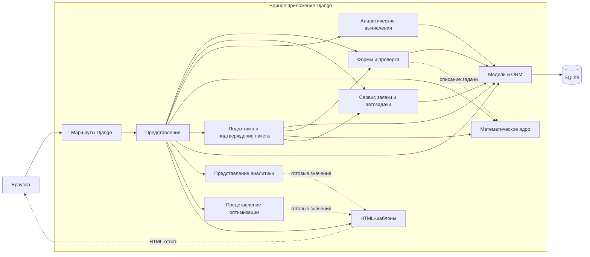
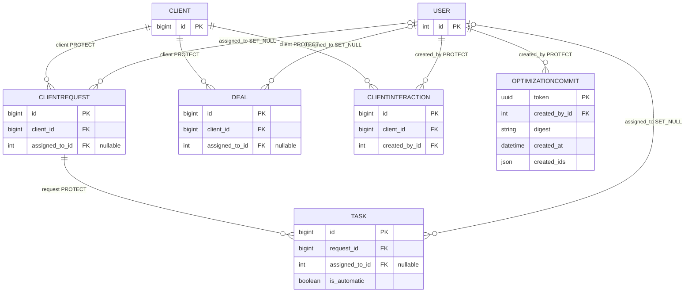

# План наглядных материалов ВКР

Единый рабочий реестр. На ВКР-3.2 проработаны только материалы первой главы. Это спецификации содержания, а не окончательные рисунки и не повтор подробного плана подразделов. Основной DOCX не изменяется. Рабочие обозначения сохраняют связь с [OUTLINE.md](OUTLINE.md); окончательные номера назначаются при вёрстке.

Codex проверяет логику, обязательные элементы, связи и происхождение данных. Пользователь выполняет окончательное оформление структурных схем в Microsoft Visio, числовых графиков при необходимости — в Excel. PNG, SVG, PDF и файлы Visio с иллюстрациями создаются только по отдельному запросу. Временная проверка пагинации текста не является изготовлением окончательных иллюстраций.

## Первая глава

### Т1. Основные операции и полномочия пользователей

- **Место:** 1.3, после объяснения ролей. Основная часть, одна компактная таблица. Сейчас в научном тексте дано связное описание; таблица остаётся черновой спецификацией, чтобы не дублировать изложение и не увеличивать объём главы.
- **Назначение:** показать границу между общей клиентской базой и ограниченной видимостью операций; отдельно выделить административное подтверждение распределения.
- **Структура:** три колонки «Операция», «Менеджер», «Администратор»; короткая сноска об активной учётной записи и проверке прав на сервере. Не добавлять отдельную диаграмму ролей с тем же содержанием.
- **Обязательные строки для переноса:**
  1. Клиентские записи: просмотр/создание/редактирование общей базы — обе роли; удаление — администратор, с учётом защищённых связей.
  2. Заявки: менеджер — свои, новая назначается ему; администратор — общий обзор и выбор активного исполнителя. Удаление — администратор, связанные задачи могут препятствовать удалению.
  3. Задачи: менеджер — при совпадении ответственного задачи и её заявки с ним; администратор — общий обзор. Удаление — администратор. Не рисовать прямую связь задачи со сделкой.
  4. Сделки и смена этапа: менеджер — назначенные ему; администратор — общий обзор. Удаление — администратор.
  5. Взаимодействия: менеджер — собственные записи, создание/просмотр/редактирование; администратор — все, включая удаление. Автор сохраняется при редактировании.
  6. Аналитика: обе роли, только по доступным им данным; общность клиентов не расширяет область отчёта менеджера.
  7. Расчёт и подтверждение нового пакета: только администратор, явное согласие на создание и дополнительное согласие для недоказанного полного решения.
  8. Административная панель: только активный суперпользователь; один признак is_staff такого доступа не даёт.
- **Связи и условия:** таблица полномочий не изображает процесс исполнения; «свои» имеет разные основания для заявок/сделок, задач и взаимодействий. Уникальность одной автозадачи относится к заявке, защита повтора пакета — к одному идентификатору подтверждения. Не обозначать это одной общей гарантией отсутствия всех дублей.
- **Основания:** [models.py](../crm/models.py), [forms.py](../crm/forms.py), [views.py](../crm/views.py), [admin_site.py](../crm/admin_site.py), [analytics.py](../crm/analytics.py), [optimization_commit.py](../crm/optimization_commit.py), [9Б, раздел 3](../docs/FINAL_ACCEPTANCE_9B.md).
- **Что перенести пользователю:** перечисленные строки и точные различия полномочий в компактную таблицу Word; при выборе Visio — воспроизвести те же колонки, не добавлять новых ролей, связей или разрешений. Не переносить пути исходных файлов в подпись итоговой таблицы.
- **Статус:** содержание сверено с реализацией; требуется согласовать необходимость включения таблицы вместо части ролевого описания. Её объём пока не включён в проверенную текстовую вёрстку.

### Материалы для 1.1, 1.2 и 1.4

В 1.1 отдельная схема не требуется: она повторяла бы будущую ER-диаграмму и схему взаимодействия из второй главы. Смысл сущностей раскрыт текстом; точные кардинальности и механизмы записи будут показаны позднее по коду. В 1.2 отдельная графическая «оценка CRM» не планируется: источники имеют разную полноту, числовые баллы и ранжирование продуктов не обоснованы. В 1.4 критерии изложены текстом; матрица результатов испытаний относится к третьей главе, не создаётся здесь.

## Правила дальнейшего пополнения

При написании каждого подраздела оценивать необходимость иллюстрации. Для принятого объекта фиксировать рабочее название, место, отдельную объясняемую мысль, обязательные элементы/стрелки/условия, точные файлы или данные и действия пользователя при переносе. Структурные и алгоритмические объекты при необходимости сопровождать компактным Mermaid-черновиком или текстовой схемой, соответствующей реальной реализации. Несколько схем не должны объяснять один и тот же аспект.

Для глав 2–3 приоритеты заданы в OUTLINE: архитектура, модель данных, алгоритмы, взаимодействие модулей, экспериментальные сравнения и проверенные сценарии. На этапе ВКР-3.2 их черновики не разрабатывались; материалы ВКР-4.1 приведены ниже. При подготовке графиков фиксировать проверенные значения, источник/запуск, оси, единицы и тип диаграммы. Не генерировать новые наблюдения, не получать распределения по seeds из медиан; отсутствие подробных данных отмечать и при необходимости отдельно согласовывать повтор эксперимента. Числовые графики в реестр пока не включены.

## ВКР-4.1 — материалы для подразделов 2.1 и 2.2

### Р1. Архитектура CRM

**Место и назначение:** 2.1; показать границы ответственности и вызовы внутри одного Django-приложения, не последовательность конкретного подтверждения (она относится к будущей Р4). Все блоки ниже, кроме браузера и файла SQLite, выполняются в одном серверном приложении. Сплошные стрелки — вызов или передача на обработку, пунктир — данные для отображения/ввода. Ответ HTML возвращается браузеру; двунаправленное поведение HTTP не следует путать с прямыми SQL-вызовами браузера.

**Обязательные уточнения:** ядро не обращается к ORM или SQLite; формы подготавливают Problem, расчёт вызывает view, при подтверждении ядро используется для проверки готового плана. Presentation получает готовые метрики, не выполняет SQL. Обычные изменения могут проходить напрямую через формы/ORM; не рисовать единственный обязательный сервис для всех операций. Стандартные auth/admin входят в Django, не являются отдельной внешней системой. Подписывание снимка также выполняется внутри приложения. Dotted Form→Core означает состав входа и использование расчётных типов, а не самостоятельное сохранение или фоновый запуск.

**Основания:** [settings](../config/settings.py), [маршруты проекта](../config/urls.py), [маршруты CRM](../crm/urls.py), [views](../crm/views.py), [forms](../crm/forms.py), [services](../crm/services.py), [analytics](../crm/analytics.py), [analytics_presentation](../crm/analytics_presentation.py), [optimization](../crm/optimization.py), [optimization_presentation](../crm/optimization_presentation.py), [optimization_commit](../crm/optimization_commit.py).

**Перенос в Visio:** сохранить границу единого приложения, направления и разные виды стрелок; при нехватке места объединить два presentation-блока в один с двумя подписями. Не добавлять облачную БД, очередь, внешние API, фоновых работников или микросервисы. Резерв — около половины страницы с подписью; окончательный размер проверить после оформления.

### Р2. Связи сущностей и ограничения целостности

**Место и назначение:** 2.1, отдельно от Р1; показать структуру хранения, не алгоритм работы и не прогнозную модель ресурсов. Ровно семь основных сущностей, включая стандартную User. Обязательные FK означают ровно одного родителя для дочерней записи, необязательные — от нуля до одного. Для каждого родителя возможно от нуля до многих дочерних записей.

**Обязательные примечания:** User.id у стандартного auth.User — AutoField (целочисленный ключ), а id CRM-моделей — BigAutoField. Для Task действует частичная уникальность request при is_automatic=true, а не уникальность всех задач заявки. Нет ребра Task–Deal, нет внешних ключей из JSON created_ids к заявкам и задачам, нет таблиц квалификаций/ставок/резервов. Условие административной роли автора журнала проверяется приложением, а не типом FK. Наличие FK заявки не означает обязательную задачу; наличие автоматической задачи обеспечивается прикладной операцией.

**Основания:** [models.py](../crm/models.py), [миграции](../crm/migrations/), стандартная модель User из установленного Django. Девять FK сверены с runtime-метаданными и состоянием миграций; результат в [контрольном протоколе](CHECK_4_1.md).

**Перенос в Visio:** использовать имена классов ClientRequest, ClientInteraction, OptimizationCommit в обычном регистре, показать обязательность родителя и 0..N детей, пояснить все SET_NULL/PROTECT. Все поля, не нужные для связей, перечислять не обязательно. Резерв — около половины страницы с подписью. Это структурная проверка схемы, не новое испытание БД на рабочих данных.

### Т2. Обозначения и происхождение параметров модели

**Место:** 2.2, перед ограничениями либо вместо части последовательных определений. Пока это содержательный черновик для переноса в Word; таблица не считается вставленной в проверенную вёрстку. Колонки не следует превращать в изображения формул: обозначения и выражения остаются редактируемыми.

| Обозначение | Смысл / единица | Происхождение | Роль |
|---|---|---|---|
| I, J | Множества новых работ и выбранных исполнителей; безразмерные индексы | Состав расчёта, локальные ID и выбранный пул | Области индексов |
| a_ij | Квалификационная допустимость; 0/1 | Экспертная оценка, отсутствие пары означает 0 | Запрет назначения |
| t_ij | Трудоёмкость допустимой пары; человеко-часы | Экспертный ввод; в эксперименте допускается генерация b/q | Новая нагрузка и стоимость |
| A_j | Полная мощность в горизонте; часы | Экспертный ввод, A>0 | Полный ресурс |
| L_j | Ранее принятая оставшаяся работа того же горизонта; часы | Экспертный ввод, 0≤L≤A | Исходная занятость |
| H_j | Остаток мощности; часы | A_j−L_j | Правая часть ограничения |
| r_j | Расчётная ставка; руб./ч | Экспертный ввод, не Deal.amount | Стоимость труда |
| c_ij | Стоимость пары; руб. | t_ij r_j | Слагаемое C |
| x_ij | Назначение; 0/1 | Переменная решения | Один исполнитель на работу |
| p_j, u_j | Новые часы и полная относительная загрузка | Назначение и входные оценки | Мощность и максимум U |
| C, U, T | Стоимость, максимальная доля загрузки, человеко-часы | Прямой расчёт полного плана | C/U — критерии; T — диагностика |
| C0, U0 | Положительный масштаб стоимости, руб.; единичный масштаб загрузки | Фиксированная нормировка до обоих методов | Сопоставимость шкал |
| α, β | Неотрицательные веса с суммой 1; безразмерные | Экспертное предпочтение | Скаляризация F |

**Основания:** [М1, разделы 3–5](../docs/OPTIMIZATION_MODEL.md), [М2, разделы 1–2](../docs/OPTIMIZATION_EXPERIMENTS.md), [_prepare и _direct_evaluate](../crm/optimization.py). Пользователь переносит таблицу как редактируемую Word-таблицу, сокращая дублирующие определения в тексте при окончательной вёрстке. Резерв — примерно половина страницы при компактной компоновке, до одной страницы при подробной; это оценка, не готовый объект. Единицы в формулах — часы, внутренний расчёт — целые минуты и Fraction.

Р1, Р2 и Т2 подготовлены как логические черновики. Р3/Р4 и графики этого этапа не разрабатывались; окончательных изображений и Visio-файлов нет.
