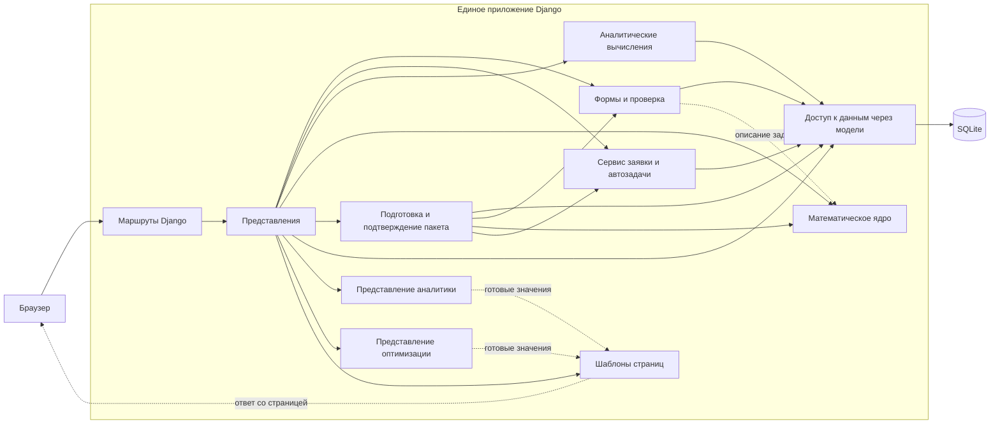
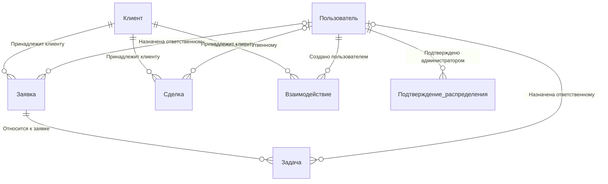
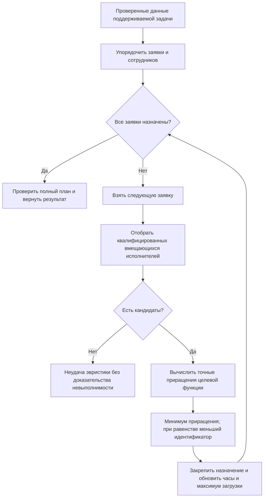
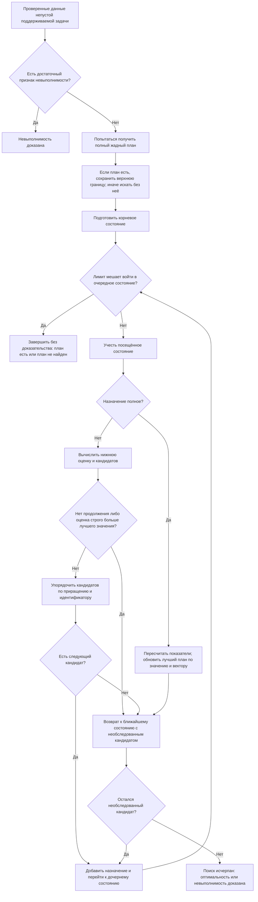

# План наглядных материалов ВКР

Единый рабочий реестр. На ВКР-3.2 проработаны только материалы первой главы. Это спецификации содержания, а не окончательные рисунки и не повтор подробного плана подразделов. Основной DOCX не изменяется. Рабочие обозначения сохраняют связь с [OUTLINE.md](OUTLINE.md); окончательные номера назначаются при вёрстке.

Codex проверяет логику, обязательные элементы, связи и происхождение данных. Пользователь выполняет окончательное оформление структурных схем в Microsoft Visio, числовых графиков при необходимости — в Excel. PNG, SVG, PDF и файлы Visio с иллюстрациями создаются только по отдельному запросу. Временная проверка пагинации текста не является изготовлением окончательных иллюстраций.

## Первая глава

### Т1. Основные операции и полномочия пользователей

- **Место:** 1.3, после объяснения ролей. Основная часть, одна компактная таблица. Сейчас в научном тексте дано связное описание; таблица остаётся черновой спецификацией, чтобы не дублировать изложение и не увеличивать объём главы.
- **Назначение:** показать границу между общей клиентской базой и ограниченной видимостью операций; отдельно выделить административное подтверждение распределения.
- **Структура:** три колонки «Операция», «Менеджер», «Администратор»; короткая сноска об активной учётной записи и проверке прав на сервере. Не добавлять отдельную диаграмму ролей с тем же содержанием.
- **Обязательные строки для переноса:**
  1. Клиентские записи: просмотр/создание/редактирование общей базы — обе роли; удаление — администратор, с учётом защищённых связей.
  2. Заявки: менеджер — свои, новая назначается ему; администратор — общий обзор и выбор активного исполнителя. Удаление — администратор, связанные задачи могут препятствовать удалению.
  3. Задачи: менеджер — при совпадении ответственного задачи и её заявки с ним; администратор — общий обзор. Удаление — администратор. Не рисовать прямую связь задачи со сделкой.
  4. Сделки и смена этапа: менеджер — назначенные ему; администратор — общий обзор. Удаление — администратор.
  5. Взаимодействия: менеджер — собственные записи, создание/просмотр/редактирование; администратор — все, включая удаление. Автор сохраняется при редактировании.
  6. Аналитика: обе роли, только по доступным им данным; общность клиентов не расширяет область отчёта менеджера.
  7. Расчёт и подтверждение нового пакета: только администратор, явное согласие на создание и дополнительное согласие для недоказанного полного решения.
  8. Административная панель: только активный суперпользователь; один признак доступа к служебной панели такого доступа не даёт.
- **Связи и условия:** таблица полномочий не изображает процесс исполнения; «свои» имеет разные основания для заявок/сделок, задач и взаимодействий. Уникальность одной автозадачи относится к заявке, защита повтора пакета — к одному идентификатору подтверждения. Не обозначать это одной общей гарантией отсутствия всех дублей.
- **Основания:** [models.py](../crm/models.py), [forms.py](../crm/forms.py), [views.py](../crm/views.py), [admin_site.py](../crm/admin_site.py), [analytics.py](../crm/analytics.py), [optimization_commit.py](../crm/optimization_commit.py), [9Б, раздел 3](../docs/FINAL_ACCEPTANCE_9B.md).
- **Что перенести пользователю:** перечисленные строки и точные различия полномочий в компактную таблицу Word; при выборе Visio — воспроизвести те же колонки, не добавлять новых ролей, связей или разрешений. Не переносить пути исходных файлов в подпись итоговой таблицы.
- **Статус:** содержание сверено с реализацией; требуется согласовать необходимость включения таблицы вместо части ролевого описания. Её объём пока не включён в проверенную текстовую вёрстку.

### Материалы для 1.1, 1.2 и 1.4

В 1.1 отдельная схема не требуется: она повторяла бы будущую ER-диаграмму и схему взаимодействия из второй главы. Смысл сущностей раскрыт текстом; точные кардинальности и механизмы записи будут показаны позднее по коду. В 1.2 отдельная графическая «оценка CRM» не планируется: источники имеют разную полноту, числовые баллы и ранжирование продуктов не обоснованы. В 1.4 критерии изложены текстом; матрица результатов испытаний относится к третьей главе, не создаётся здесь.

## Правила дальнейшего пополнения

При написании каждого подраздела оценивать необходимость иллюстрации. Для принятого объекта фиксировать рабочее название, место, отдельную объясняемую мысль, обязательные элементы/стрелки/условия, точные файлы или данные и действия пользователя при переносе. Структурные и алгоритмические объекты при необходимости сопровождать компактным Mermaid-черновиком или текстовой схемой, соответствующей реальной реализации. Несколько схем не должны объяснять один и тот же аспект.

Для глав 2–3 приоритеты заданы в OUTLINE: архитектура, модель данных, алгоритмы, взаимодействие модулей, экспериментальные сравнения и проверенные сценарии. На этапе ВКР-3.2 их черновики не разрабатывались; материалы ВКР-4.1 приведены ниже. При подготовке графиков фиксировать проверенные значения, источник/запуск, оси, единицы и тип диаграммы. Не генерировать новые наблюдения, не получать распределения по seeds из медиан; отсутствие подробных данных отмечать и при необходимости отдельно согласовывать повтор эксперимента. Числовые графики в реестр пока не включены.

## ВКР-4.1 — материалы для подразделов 2.1 и 2.2

### Р1. Архитектура CRM

**Место и назначение:** 2.1; показать границы ответственности и вызовы внутри одного Django-приложения, не последовательность конкретного подтверждения (она относится к будущей Р4). Все блоки ниже, кроме браузера и файла SQLite, выполняются в одном серверном приложении. Сплошные стрелки — вызов или передача на обработку, пунктир — данные для отображения/ввода. Ответ HTML возвращается браузеру; двунаправленное поведение HTTP не следует путать с прямыми SQL-вызовами браузера.



**Обязательные уточнения:** ядро не обращается к базе данных; формы подготавливают описание расчётной задачи, расчёт вызывает представление. При подтверждении ядро проверяет готовый план. Модули представления получают готовые показатели и не запрашивают БД. Обычные изменения могут проходить напрямую через формы и модели; не рисовать единственный обязательный сервис для всех операций. Аутентификация и административная панель входят в Django. Подписывание снимка выполняется внутри приложения. Пунктир «Формы → Математическое ядро» означает передачу описания задачи, а не самостоятельное сохранение или фоновый запуск.

**Основания:** [settings](../config/settings.py), [маршруты проекта](../config/urls.py), [маршруты CRM](../crm/urls.py), [views](../crm/views.py), [forms](../crm/forms.py), [services](../crm/services.py), [analytics](../crm/analytics.py), [analytics_presentation](../crm/analytics_presentation.py), [optimization](../crm/optimization.py), [optimization_presentation](../crm/optimization_presentation.py), [optimization_commit](../crm/optimization_commit.py).

**Перенос в Visio:** сохранить границу единого приложения, направления и разные виды стрелок; при нехватке места объединить два блока представления данных в один с двумя подписями. Не добавлять облачную БД, очередь, внешние API, фоновых работников или микросервисы. Резерв — около половины страницы с подписью; окончательный размер проверить после оформления.

### Р2. Связи сущностей и ограничения целостности

**Место и назначение:** 2.1, отдельно от Р1; показать структуру хранения, не алгоритм работы и не прогнозную модель ресурсов. Ровно семь основных сущностей, включая учётную запись пользователя. Обязательные внешние ключи означают ровно одного родителя для дочерней записи, необязательные — от нуля до одного. Для каждого родителя возможно от нуля до многих дочерних записей.



**Обязательные примечания:** подписи связей читаются от зависимой записи к родительской. В Visio название «Подтверждение распределения» переносится с пробелом; подчёркивание нужно только для идентификатора Mermaid. Числовые ключи в окончательной схеме можно обозначить как «Идентификатор», а ключ подтверждения — как «Уникальный идентификатор подтверждения». Для одной заявки допускается не более одной автоматической задачи; ручных задач может быть несколько. Прямой связи задачи со сделкой нет. Список созданных идентификаторов в подтверждении не образует внешних ключей. Таблиц квалификаций, ставок и резервов нет. Полномочия автора подтверждения проверяются приложением.

**Правила удаления для переноса:** клиент защищён от удаления при наличии связанных заявок, сделок или взаимодействий; заявка — при наличии задач. Учётная запись автора взаимодействия или подтверждения также защищена от удаления. Необязательные ссылки на ответственного у заявок, задач и сделок при удалении его учётной записи очищаются; сами записи сохраняются. Внешний ключ задачи не гарантирует, что у каждой заявки обязательно есть задача: автоматическую задачу создаёт прикладная операция.

**Основания:** [models.py](../crm/models.py), [миграции](../crm/migrations/), стандартная модель пользователя из установленного Django. Девять внешних ключей сверены с runtime-метаданными и состоянием миграций; результат в [контрольном протоколе](CHECK_4_1.md).

**Перенос в Visio:** использовать только семь русских названий сущностей из черновика, показать обязательность родителя и 0..N зависимых записей, добавить русские примечания о запрете удаления и очистке ссылок. Все поля, не нужные для связей, перечислять не обязательно. Резерв — около половины страницы с подписью. Это структурная проверка схемы, не новое испытание БД на рабочих данных.

### Т2. Обозначения и происхождение параметров модели

**Место:** 2.2, перед ограничениями либо вместо части последовательных определений. Пока это содержательный черновик для переноса в Word; таблица не считается вставленной в проверенную вёрстку. Колонки не следует превращать в изображения формул: обозначения и выражения остаются редактируемыми.

| Обозначение | Смысл / единица | Происхождение | Роль |
|---|---|---|---|
| I, J | Множества новых работ и выбранных исполнителей; безразмерные индексы | Состав расчёта, локальные идентификаторы и выбранный пул | Области индексов |
| a_ij | Квалификационная допустимость; 0/1 | Экспертная оценка, отсутствие пары означает 0 | Запрет назначения |
| t_ij | Трудоёмкость допустимой пары; человеко-часы | Экспертный ввод; в эксперименте — генерация из параметров тестового набора | Новая нагрузка и стоимость |
| A_j | Полная мощность в горизонте; часы | Экспертный ввод, A>0 | Полный ресурс |
| L_j | Ранее принятая оставшаяся работа того же горизонта; часы | Экспертный ввод, 0≤L≤A | Исходная занятость |
| H_j | Остаток мощности; часы | A_j−L_j | Правая часть ограничения |
| r_j | Расчётная ставка; руб./ч | Экспертный ввод, не сумма сделки | Стоимость труда |
| c_ij | Стоимость пары; руб. | t_ij r_j | Слагаемое C |
| x_ij | Назначение; 0/1 | Переменная решения | Один исполнитель на работу |
| p_j, u_j | Новые часы и полная относительная загрузка | Назначение и входные оценки | Мощность и максимум U |
| C, U, T | Стоимость, максимальная доля загрузки, человеко-часы | Прямой расчёт полного плана | C/U — критерии; T — диагностика |
| C0, U0 | Положительный масштаб стоимости, руб.; единичный масштаб загрузки | Фиксированная нормировка до обоих методов | Сопоставимость шкал |
| α, β | Неотрицательные веса с суммой 1; безразмерные | Экспертное предпочтение | Скаляризация F |

**Основания:** [М1, разделы 3–5](../docs/OPTIMIZATION_MODEL.md), [М2, разделы 1–2](../docs/OPTIMIZATION_EXPERIMENTS.md), [_prepare и _direct_evaluate](../crm/optimization.py). Пользователь переносит таблицу как редактируемую Word-таблицу, сокращая дублирующие определения в тексте при окончательной вёрстке. Резерв — примерно половина страницы при компактной компоновке, до одной страницы при подробной; это оценка, не готовый объект. Единицы в формулах — часы, внутренний расчёт — целые минуты и точные рациональные числа.

Р1, Р2 и Т2 подготовлены как логические черновики. Р3/Р4 и графики этого этапа не разрабатывались; окончательных изображений и Visio-файлов нет.

Редакция ВКР-4.1.1: пользовательские подписи Р1, Р2 и Т2 русифицированы; внутренняя структура связей сохранена. Проверка — [CHECK_4_1_1.md](CHECK_4_1_1.md).

## ВКР-4.2 — алгоритмы и подтверждение

### Р3. Алгоритмы распределения заявок

**Подраздел:** 2.3. **Назначение:** два согласованных вида поиска одной задачи; не повторяют архитектуру Р1 или формулы параметров Т2. Все подписи для пользователя русские. Формулы обозначаются номерами из текста, без полного дублирования вывода.

**Часть А — жадный алгоритм.** Обязательны порядок стабильных идентификаторов, отбор по квалификации и остатку, минимум приращения (2.12), правило равенства, отсутствие возврата, разные окончания: полный допустимый план и неудача эвристики.



Пустой пакет возвращает оптимальный пустой план. При заранее пустой квалификационной строке возможен ранний отказ эвристики, без вычисления нормировки пустого максимума. Полный непустой план сам по себе не доказывает оптимальность.

**Часть Б — метод ветвей и границ.** Обязательны структурные проверки, необязательное начальное жадное решение, корень, глубинный обход и возврат, оценка (2.14), строгое отсечение, лексикографическое правило и контроль незавершённого поиска.



**Связи и условия:** при возврате восстанавливаются часы и вектор частичного плана. В блоке возврата ищется кандидат с учётом всех предков, а не только текущего состояния. Если оценка равна лучшему значению, ветвь не отсекается. Отсутствие начального жадного плана не ведёт к доказанной невыполнимости. При исчерпании дерева ровно на лимите доказательство сохраняется: лимит проверяется лишь перед входом в реально требующее исследования состояние. Пустая задача и ошибки входа обрабатываются до изображённого поиска.

**Основания:** [ядро](../crm/optimization.py), [М1 §7](../docs/OPTIMIZATION_MODEL.md), [тесты](../crm/test_optimization.py), новые проверки в [CHECK_4_2.md](CHECK_4_2.md).

**Перенос в Visio:** воспроизвести части А и Б рядом или последовательно, сохранить условия ромбов и обратные стрелки, выделить доказанные и недоказанные окончания. Не превращать число шагов в признак оптимальности. Оценочный резерв двух частей вместе — 1,5–2 страницы с подписями; схемы пока не вставлены.

**Ограничения:** это логика поиска, не построчная программа и не график экспериментального времени; сложность в худшем случае остаётся экспоненциальной. Временной лимит кооперативный. Схема не обещает вычисления глобального разрыва оптимальности.

### Р4. Расчёт и подтверждение распределения

**Подраздел:** 2.4. **Назначение:** показать границу рекомендации и записи в БД, атомарность и повтор одного подтверждения. Это проектный протокол, не повтор будущего подробного разбора программных функций в 3.2.

```mermaid
sequenceDiagram
 participant A as Администратор
 participant W as Веб-интерфейс
 participant V as Серверная проверка данных
 participant K as Математическое ядро
 participant P as Подготовка и проверка снимка
 participant S as Сервис сохранения
 participant D as База данных
 A->>W: Ввод экспертных оценок
 W->>V: Проверка прав и формы
 V->>K: Расчёт обоими методами
 K-->>V: Планы, показатели и доказанность
 V->>P: Полный допустимый план точного поиска
 P-->>W: Рекомендация и подписанный снимок без создания заявок
 A->>W: Клиенты, описания, горизонт, подтверждение оценок
 W->>V: Проверка деталей пакета
 V->>P: Проверка снимка и подготовка предпросмотра
 P-->>W: Предпросмотр без создания заявок
 A->>W: Подтвердить создание; отдельно принять недоказанный план
 W->>S: Финальное подтверждение
 S->>P: Проверка подписи, автора, прав и содержания
 S->>D: Найти ранее завершённое подтверждение
 alt Совпадающее подтверждение уже завершено
 D-->>S: Прежние идентификаторы
 S-->>W: Вернуть прежний результат без новых записей
 else Новое подтверждение
 S->>P: Проверить исходные 15 минут и актуальность входов
 P->>K: Проверить готовое назначение и точные показатели без поиска
 K-->>P: Проверенные показатели
 P-->>S: Готовый проверенный план
 S->>D: Начать транзакцию и закрепить уникальный идентификатор
 S->>V: Повторить проверки прав, сотрудников, клиентов и сроков
 S->>D: Создать все заявки и автоматические задачи; заполнить подтверждение
 alt Все операции и финальные проверки успешны
 D-->>S: Зафиксировать весь пакет
 S-->>W: Созданные идентификаторы
 else Поздняя ошибка
 D-->>S: Откатить пакет вместе с записью подтверждения
 S-->>W: Ошибка; при временном отказе повторить то же действие
 end
 end
```

**Обязательные условия и стрелки:** без полного допустимого плана точного поиска подготовка недоступна; при недоказанной оптимальности нужно отдельное согласие. Неуспешные проверки до транзакции не ведут к записи. Совпадение прежнего подтверждения означает тот же идентификатор, автора и отпечаток; изменение содержимого с прежним идентификатором отклоняется. Чтение завершённого результата допускается после истечения 15 минут; новое сохранение — нет. Предпросмотр не продлевает исходный срок. При неопределённом сетевом ответе повторяют прежнее подтверждение.

**Основания:** [формы](../crm/forms.py), [представления](../crm/views.py), [подтверждение](../crm/optimization_commit.py), [сервисы](../crm/services.py), [модели](../crm/models.py), [тесты подтверждения](../crm/test_optimization_commit.py).

**Перенос в Visio:** семь участников, последовательность сообщений, альтернативы повтора/нового действия и фиксации/отката. Обозначить область транзакции от закрепления идентификатора до финальной записи результата; не включать в неё первоначальный расчёт или предпросмотр. При нехватке места объединить служебные сообщения проверки, сохранив смысл ветвей. Резерв — 0,75–1 страница; окончательный размер после оформления.

**Ограничения:** подпись не шифрует данные и не доказывает экспертные оценки. Защита повтора зависит от сохранности журнала и не устраняет дубли между независимыми пакетами. Построчные блокировки SQLite, глобальные резервы часов и календарные гарантии не изображать как действующие возможности. Окончательные изображения не создавались.

## ВКР-5.1 — реальные интерфейсные иллюстрации

Р7 и Р8 показывают действующий интерфейс, а не заменяют Р1–Р4 схемами с теми же связями. В этом этапе новых скриншотов, изображений или данных для них не создавалось; браузер не запускался. Ниже — спецификации отбора и будущего оформления. Перечисленные оригиналы просмотрены как исторические кандидаты, не как новые результаты испытаний. Числа на них не становятся измерениями ВКР-5.1.

### Р7. Интерфейс управления сделками и аналитика

**Место:** 3.1. **Мысль:** сопоставить управление текущими сделками и наблюдение их показателей. Два небольших изображения вместо галереи всех страниц. Предварительный общий резерв Р7а+Р7б — 0,75–1 страница с подписями; читаемость проверить на окончательном размере в Word.

**Р7а — Канбан-доска.** Страница `/deals/kanban/`. Обязательно показать пять русских названий этапов и счётчики, одну-две читаемые карточки с текущим этапом и серверным выбором нового этапа/кнопкой «Переместить». Возможность перетаскивания обозначить выносной подписью, не изображать несуществующую кнопку. Статичный кадр не доказывает успешность перемещения или обработку конфликта.

- **Источник:** [шаблон доски](../crm/templates/crm/deal_kanban.html), [карточка](../crm/templates/crm/_kanban_card.html), [колонки](../crm/kanban.py), [сценарий браузера](../crm/static/crm/kanban.js). Существующий кандидат — [пять колонок, Д2.5](../docs/evidence/d2_5/05-after-kanban-five-columns-1920.png).
- **Наглядные тестовые данные для будущего кадра:** отдельная синтетическая демобаза, короткие названия учебных компаний и сделок, сделки во всех пяти этапах, минимум два ответственных при показе администратора. Это задание будущей подготовки, не утверждение о новом создании записей. Не использовать стрессовые длинные имена как основной пример.
- **Кандидат и ограничения:** имеющийся кадр содержит учебные записи и длинные стрессовые карточки. Полная высокая доска при уменьшении станет нечитаемой. Предпочесть явно обозначенные фрагменты: полосу пяти заголовков со счётчиками и увеличенную карточку ниже; не выдавать их за единый непрерывный экран. При необходимости нового кадра пользователь позднее снимает компактный набор самостоятельно.
- **Предполагаемая подпись:** «Канбан-доска сделок: этапы, счётчики и изменение состояния карточки».
- **Оформление:** сохранить исходный файл без дублирования evidence, использовать ссылку/вставку оригинала в Word. Подписать назначение элементов по-русски; не перерисовывать интерфейс в Visio. Не подменять текст, суммы и состояния на снимке. При нехватке читаемости подробный вид вынести в приложение.

**Р7б — Аналитическая панель.** Страница `/analytics/`. Показать выбор периода, основные количества сделок, конверсию закрытых сделок, сумму успешно завершённых сделок, распределения и текущую нагрузку с просрочками. Сохранить подпись выбранного периода и UTC, чтобы не создавать впечатление исторической реконструкции воронки.

- **Источник:** [шаблон](../crm/templates/crm/analytics.html), [расчёт](../crm/analytics.py), [представление](../crm/analytics_presentation.py), [определения](../docs/ANALYTICS_METRICS.md). Кандидат — [панель Д2.5](../docs/evidence/d2_5/17-analytics-1440.png); мобильный [кадр 9Б](../docs/evidence/9b/analytics-320.png) доступен как дополнительный материал, не выбран автоматически для печати.
- **Тестовая информация:** в будущем компактном демонаборе предусмотреть открытые, успешные и проигранные сделки, разные типы зарегистрированных взаимодействий, согласованные заявки/задачи с прошедшим и будущим сроками. Все числа должен рассчитать сам сервер. Не переносить заранее придуманные показатели на картинку. В просмотренном историческом кандидате взаимодействия представлены одним типом; это ограничивает наглядность распределения, а не означает ошибку расчёта.
- **Предполагаемая подпись:** «Аналитическая панель: сделки и взаимодействия за период, нагрузка на текущий момент».
- **Оформление:** выбрать читаемые фрагменты верхних показателей и нижней нагрузки, явно обозначить составной вид. Не дублировать все таблицы из панели. Не называть сумму выручкой; не подставлять ноль вместо «Нет данных» или недоступного денежного итога. Период и текущая нагрузка должны оставаться различимыми.

**Что исключить для обеих частей:** реальные ФИО, телефоны, адреса электронной почты, реквизиты клиентов, рабочие учётные записи, адресную строку с токенами и отладочную информацию. Для нового кадра использовать только вымышленные имена и несекретные тестовые учётные записи. Проверить выбранные области перед публикацией. Технические URL и пути источников не переносить в подпись рисунка. Авторизация и заполнение отдельной демобазы выполняются пользователем при последующей съёмке, не в рамках этого этапа.

### Р8. Расчёт распределения и предварительный просмотр

**Место:** 3.2. **Мысль:** показать, что рекомендация с показателями и доказанностью отделена от явного создания записей. Один составной рисунок или два компактных фрагмента; не повторять последовательность сообщений Р4. Предварительный резерв — 0,5–0,75 страницы с подписью; при необходимости подробные исходные таблицы перенести в приложение.

**Р8а — Расчёт.** Страница `/optimization/`. Нужны экспертные мощности/занятость/ставки и матрица квалифицированных трудоёмкостей, веса, результаты двух методов с назначенными сотрудниками, C/U/T/F, статусом доказанности и причиной остановки. Если весь экран не читается, небольшой фрагмент экспертной таблицы сопоставить с блоками результатов; сохранить реальные значения, порядок и подпись источника оценок. Не изображать отсутствующий автоматический импорт рабочего времени.

**Р8б — Предпросмотр.** Серверный ответ `/optimization/preview/` после подготовки пакета. Показать выбранных учебных клиентов, заявки и ответственных, общий срок, предупреждение об отсутствии глобального резервирования, согласие на создание и кнопку подтверждения. Для недоказанного плана показать дополнительное согласие только тогда, когда оно действительно выведено системой; не дорисовывать его на кадре доказанного результата.

- **Источники реализации:** [форма и ограничения](../crm/forms.py), [результаты](../crm/templates/crm/optimization.html), [предпросмотр](../crm/templates/crm/optimization_confirm.html), [вывод показателей](../crm/optimization_presentation.py), [подтверждение](../crm/optimization_commit.py).
- **Кандидаты:** [результаты Д2.5](../docs/evidence/d2_5/20-optimization-1440.png), [предпросмотр Д2.5](../docs/evidence/d2_5/24-preview-1440.png), [расчёт 9Б](../docs/evidence/9b/optimization-1440.png). Первые два просмотрены: первый показывает результаты М1 и переход к подготовке, но не всю исходную таблицу; второй — окончательный предпросмотр доказанного плана с одним согласием. Эти ограничения не скрывать. Старый предпросмотр содержит историческую дату; его нельзя выдавать за текущую возможность создания с будущим сроком.
- **Данные для будущей съёмки:** существующий контроль М1 из проекта с двумя учебными работами и сотрудниками, вымышленными клиентами; срок выбирается будущим относительно съёмки. Это план воспроизведения, не новый эксперимент. Для варианта недоказанной оптимальности применять только реально полученный интерфейсом полный недоказанный результат, не менять статус на изображении и не обещать, что М1 даст такой статус точного метода.
- **Предполагаемая подпись:** «Расчёт распределения и предварительный просмотр пакета перед созданием заявок»; внутренние подписи «а — исходные оценки и результаты», «б — предварительный просмотр и подтверждение».
- **Оформление пользователем:** собрать реальные фрагменты в Word, сохранить числовые подписи и предупреждения, при желании добавить русские выноски в Visio без имитации элементов интерфейса. Не включать полный длинный сравнительный отчёт: численные исследования относятся к 3.3. Проверить читабельность и происхождение всех фрагментов; не смешивать разные расчёты как один сценарий.
- **Исключить:** содержимое подписанного снимка, скрытые поля, токены, секреты, реальные клиенты/сотрудники, сетевые журналы. В кадре предпросмотра остановиться до подтверждения; новые записи ради рисунка создавать не требуется.

Спецификации Р7–Р8 подготовлены по коду, шаблонам и существующим оригиналам. Окончательные изображения не созданы и не вставлены. Новая визуальная проверка работающего интерфейса — отдельная будущая задача. Контроль этапа — [CHECK_5_1.md](CHECK_5_1.md).
